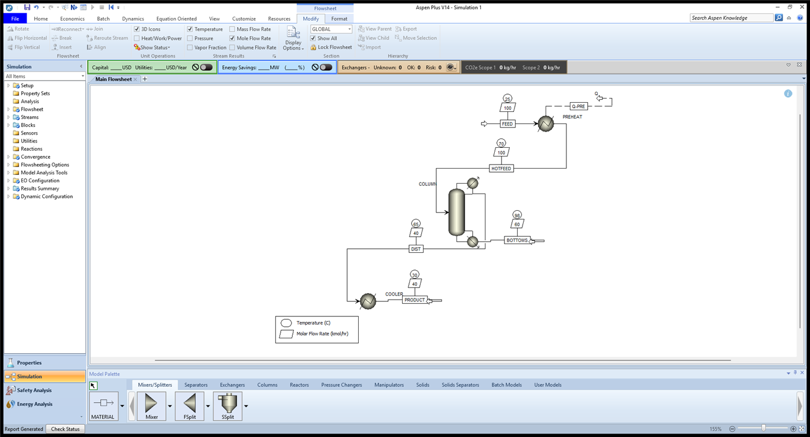
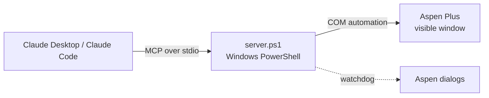

# Aspen Plus MCP server

**Let Claude build, run and analyse Aspen Plus simulations, live in a visible Aspen window.**

You describe the process in plain language. Claude adds the components, blocks and streams, sets the specs, runs the solver, and reads back the results. Meanwhile you watch the flowsheet appear in Aspen Plus. It works with Claude Desktop (Chat and Code tabs) and Claude Code, on Windows.



*Built and solved entirely through the server's tools: 100 kmol/h of 40 % methanol preheated to 70 °C, separated in a 15-stage column (reflux ratio 1.5, D/F 0.4), distillate cooled to 30 °C. Stream labels show temperature (°C) and molar flow (kmol/h). This is the kind of request you'd give Claude in one sentence.*

- **Plug and play:** one install command, no Python or Node.js. It's plain Windows PowerShell, which every Windows PC has.
- **Live:** Claude drives a real Aspen window that you can watch and use yourself, and Claude can take screenshots of it.
- **Safe with your work:** files are opened as copies. Folders you protect are never written to.
- **Broad coverage:** about 40 tools, covering components, property methods, any block, streams with mole, mass or solids flows, RadFrac, reactors (RStoic, kinetic RCSTR and RPlug), design specs, sensitivity studies, calculators, results, reports and screenshots. For models without a dedicated tool, Claude reads Aspen's own help text for each input field.

## Requirements

- Windows 10 or 11, which includes Windows PowerShell 5.1.
- Aspen Plus V11 or newer, installed and licensed. It's tested on V14. The server finds the installed version automatically.
- Claude Desktop or Claude Code.

## Install

1. **Get the code.** Use **Code → Download ZIP** on GitHub and unzip it somewhere permanent (for example `Documents\aspen-mcp`), or clone it:
   ```bash
   git clone https://github.com/vishalkaay/aspen-mcp.git
   ```
2. **Run the installer** from that folder:
   ```bash
   powershell -ExecutionPolicy Bypass -File install.ps1
   ```
   It registers the server with Claude Desktop and Claude Code. It changes only its own `aspen-plus` entry in each config file and backs each file up first.
3. **Start a new Claude chat or session.** MCP tools load when a session starts. If they don't appear, fully quit Claude Desktop (tray icon → Quit) and reopen it.

Then ask Claude something like *"Start a new Aspen simulation with water and methanol."* An Aspen window opens.

**Check that everything works**, at any time:

```bash
powershell -ExecutionPolicy Bypass -File check.ps1 -Aspen
```

This checks Windows, PowerShell, Aspen Plus, the Claude registration and the server, and opens a real Aspen window for about 30 seconds. Every problem it finds comes with a fix. Leave out `-Aspen` for a 5-second check that doesn't start Aspen.

**Uninstall** with `install.ps1 -Uninstall`, then delete the folder.

## What you can ask

> Start a METCBAR simulation with water and methanol (NRTL). Feed 80 kmol/h water and 20 kmol/h methanol at 25 °C and 1.5 bar into a heater that takes it to 60 °C. Run it and give me the duty.

> Build a 15-stage column for that feed and find the reflux ratio that gives 99 mol% methanol in the distillate. Then show me reboiler duty against reflux ratio from 1 to 3.

> Add an esterification reactor: ethanol + acetic acid → ethyl acetate + water, power-law kinetics with k = 1e-5, in a 1 m³ CSTR at 70 °C. What conversion do I get?

> Open `C:\work\plant.bkp`, list every RadFrac column with its condenser and reboiler duty, and take a screenshot of the flowsheet.

> What inputs does a Flash2 block need? Set FLASH1 to 40 °C and 2 bar.

More worked examples are in [docs/EXAMPLES.md](docs/EXAMPLES.md).

## Tools

| Area | Tools |
|---|---|
| Session | `aspen_new` (blank, unit set METCBAR/MET/SI/ENG), `aspen_open` (.bkp/.apw/.apwz, as a working copy), `aspen_info`, `aspen_save`, `aspen_close` |
| Build | `aspen_add_components` (fluids or solids), `aspen_remove_component`, `aspen_set_property_method`, `aspen_set_units`, `aspen_add_block`, `aspen_add_stream` (material/heat/work), `aspen_connect`, `aspen_disconnect`, `aspen_delete`, `aspen_set_stream` (mole/mass/std-volume flows or fractions, any substream), `aspen_flowsheet` |
| Models | `aspen_radfrac` (stages, condenser, reboiler, feeds, pressure, the two operating specs), `aspen_rstoic` (reactions by conversion or extent), `aspen_reactions` (power-law kinetics), `aspen_kinetic_reactor` (RCSTR/RPlug) |
| Any input | `aspen_describe_inputs` (Aspen's help text and allowed values for every field), `aspen_get`, `aspen_set`, `aspen_list`, `aspen_tree`, `aspen_find`, `aspen_add_row` |
| Analysis | `aspen_design_spec`, `aspen_sensitivity`, `aspen_calculator` (Fortran), `aspen_analysis_results` |
| Run | `aspen_run` (explains it when Aspen skips a run for incomplete input), `aspen_status`, `aspen_stop`, `aspen_reinit`, `aspen_report` (search the .rep) |
| Results | `aspen_streams` (T, P, vapour fraction, flows, components, solid substreams), `aspen_block_results`, `aspen_column_results` (duties, ratios, stage T/P/L/V and x/y profiles) |
| View and files | `aspen_screenshot`, `aspen_list_files`, `aspen_read_file` (read .bkp/.rep/.csv as text without Aspen) |

Everything in Aspen is a node in its variable tree, so anything without a dedicated tool is still reachable. Claude uses `aspen_describe_inputs` to learn what a block's fields mean, then `aspen_set` to fill them in. For example:

| What | Path |
|---|---|
| Stream input temperature | `\Data\Streams\FEED\Input\TEMP\MIXED` |
| Stream result temperature | `\Data\Streams\OUT\Output\TEMP_OUT\MIXED` |
| Block spec / result | `\Data\Blocks\H1\Input\TEMP`, `\Data\Blocks\H1\Output\QCALC` |
| Column reboiler duty | `\Data\Blocks\C1\Output\REB_DUTY` |
| Design spec result | `\Data\Flowsheeting Options\Design-Spec\DS-1\Output\FINAL_VAL\1` |

## Configuration (optional)

Copy `config.example.json` to `config.json` and edit it. Without it, the defaults below apply.

| Key | Default | Meaning |
|---|---|---|
| `protected_paths` | `[]` | Folders that are never written to. Files there always open as copies, and saving or exporting into them is refused. Put your coursework or plant models here. |
| `workspace` | `workspace` | Where working copies, saved cases, reports and screenshots go. |
| `default_unit_set` | `METCBAR` | Unit set for `aspen_new` (C, bar, kmol/h, kg/h). |
| `run_wait_seconds` | `40` | How long `aspen_run` waits before handing back and letting Claude poll. |
| `progid` | `auto` | Aspen version to use. `auto` picks the newest one installed; to choose, give e.g. `Apwn.Document.40.0` (V14). |
| `confirm_dialogs` | `["Copy Units From"]` | Aspen dialog titles answered with OK. Any other dialog that would block automation is closed. |
| `quit_aspen_on_exit` | `false` | Quit Aspen when Claude disconnects. Off, so unsaved work stays open. |

## Troubleshooting

| Problem | Fix |
|---|---|
| Claude has no Aspen tools | Start a **new** session. Run `check.ps1`; if it says "not registered", run `install.ps1` again. Then fully quit and reopen Claude Desktop. |
| Claude can't see the Aspen window I opened | The server can't attach to an Aspen window you opened yourself, because Aspen doesn't allow it. Let Claude open the file with `aspen_open`; it then drives that window while you watch. |
| `Unexpected Error` when starting a simulation | Aspen couldn't start a case, which is almost always licensing. Check that Aspen opens by hand and a license is free, then run `check.ps1 -Aspen`. The server already restores license variables such as `LSHOST`, which Claude doesn't pass to MCP servers. |
| "Aspen did not run: required input is incomplete" | The result lists the incomplete blocks. Ask Claude to complete them; `aspen_describe_inputs` shows what each field means. |
| Script is blocked or "not digitally signed" | Use the commands as shown (`-ExecutionPolicy Bypass`). The installer also unblocks files that came in a downloaded ZIP. |
| A different Aspen version is used | Set `"progid"` in `config.json`. `check.ps1` lists the installed versions. |
| Something else | See `logs\server.log`; every tool call is logged with its timing and error. |

## How it works



- **Layout.**
  - `server.ps1`: the stdio loop and configuration.
  - `lib\Protocol.ps1`: JSON-RPC handling and the tool registry.
  - `lib\Com.ps1`: COM access, through a small compiled C# helper for speed.
  - `lib\Session.ps1`: the Aspen lifecycle, protection, unit sets and run status.
  - `lib\Dialogs.ps1`: the dialog watchdog.
  - `lib\Detect.ps1`: Aspen version detection.
  - `tools\*.ps1`: the tools themselves.
- **COM from PowerShell is slow.** Calling Aspen's COM members through PowerShell's COM layer costs about 20 ms per call. The calls go through a compiled helper instead, at about 1 ms, and whole-subtree walks run inside it.
- **Trimmed environment.** MCP hosts start servers with only part of the environment. Without `LSHOST`, Aspen can't find its license server, so the server restores missing variables from the registry when it starts.
- **Hidden dialogs.** Aspen sometimes raises a modal dialog that its "suppress dialogs" option misses, and the COM call then blocks forever. A watchdog answers or closes such dialogs, and the tool result says what it did.
- **Units and bases.** A feed's flow `BASIS` doesn't change its flow cells' units. Mass flows are written with `SetValueUnitAndBasis` in the unit set's unit. Blank METCBAR is incomplete, so it's completed from `data\METCBAR.json`.
- **Skipped runs.** With required input missing, Aspen silently doesn't run. The server notices, and lists the incomplete objects using Aspen's input-status flags.

## Tests

```bash
powershell -ExecutionPolicy Bypass -File tests\run-all.ps1
```

This runs every suite, about 8 minutes, and opens Aspen windows. Use `-Quick` for the two suites that don't need Aspen.

| Suite | What it checks | Aspen |
|---|---|---|
| `protocol` | MCP handshake, tool schemas, errors, file tools | no |
| `install` | Installer on temporary copies of real configs: adds only its entry, re-running changes nothing, uninstall restores each file byte for byte | no |
| `live` | Heater flowsheet from scratch, results, mass balance, screenshot, save, protected folders | yes |
| `models` | RadFrac, RStoic, design spec, sensitivity, solids | yes |
| `advanced` | Input help, kinetic RCSTR/RPlug, calculator | yes |

Optional inputs:
- `-SampleBkp file.bkp` turns on the `.bkp` reading tests.
- `-ProtectedFile file.bkp` turns on the protected-folder tests; the file must be inside a folder listed in `protected_paths`.

## Limits

- **Windows only**, because Aspen Plus and its COM interface are Windows-only. One simulation per Claude session.
- **Cold starts:** large flowsheets can take minutes to converge from a cold start. Claude polls `aspen_status` while it runs.
- **Not covered:** electrolyte chemistry setup (the Elec Wizard), property-parameter regression, Aspen's plots, costing (APEA), Energy Analyzer, Dynamics, EO mode and custom ACM/Fortran unit models.
- **Flowsheet layout:** new blocks are placed wherever Aspen puts them; the server doesn't arrange the drawing.
- **Tested setup:** Windows 11, Aspen Plus V14, English locale. The dialog watchdog matches English dialog titles.

## License

MIT, see [LICENSE](LICENSE). Aspen Plus is a product of AspenTech and needs its own license; this project isn't affiliated with AspenTech.
